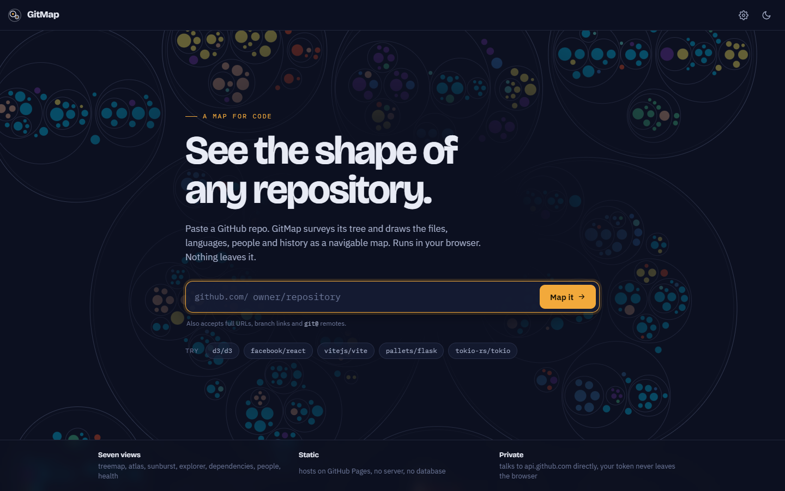
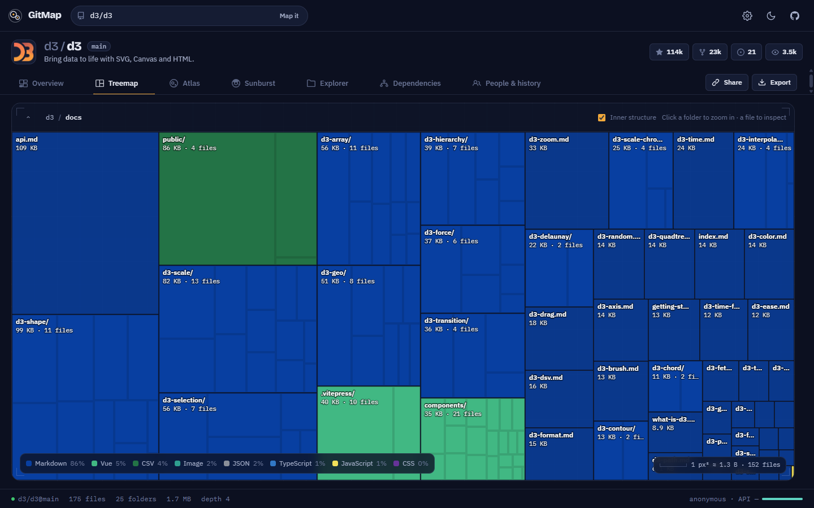
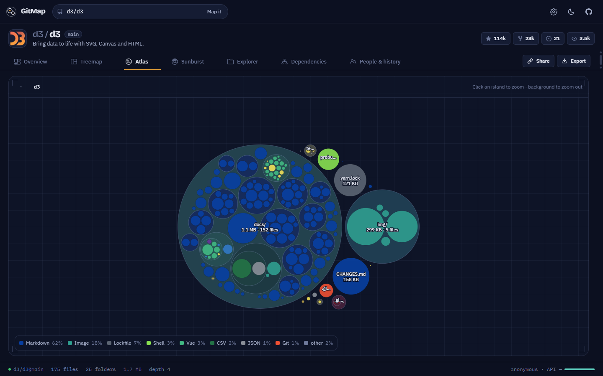
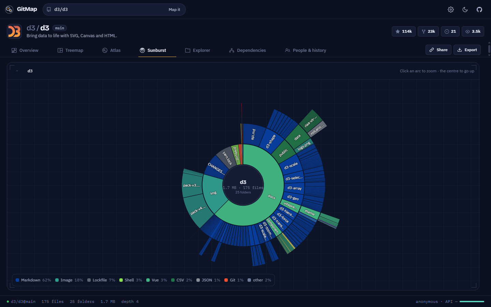
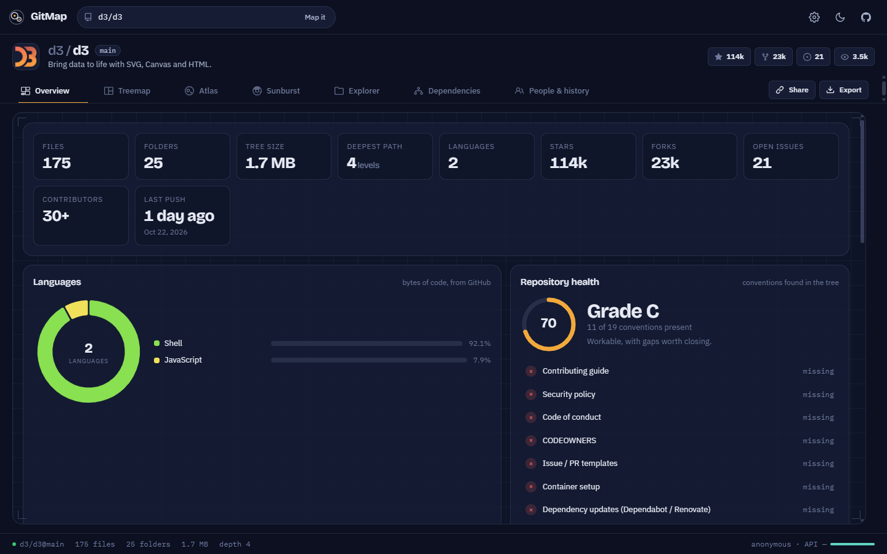
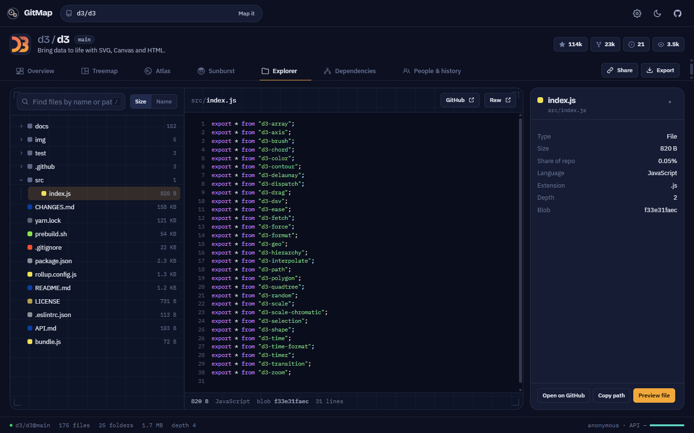
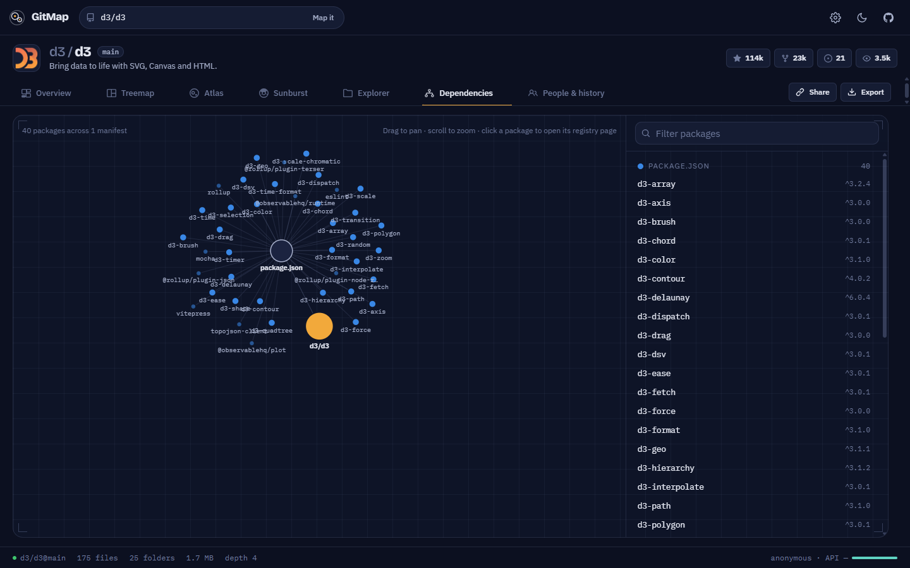

<p align="center">
  
</p>

<h1 align="center">GitMap</h1>

<p align="center">
  <strong>See the shape of any GitHub repository.</strong><br/>
  Paste a repo. Get a navigable map of its files, languages, people and history.<br/>
  Static, zero-build, hosts free on GitHub Pages.
</p>

<p align="center">
  <a href="https://abdulmanan69.github.io/gitmap/"><strong>Live demo → abdulmanan69.github.io/gitmap</strong></a>
</p>

<p align="center">
  <a href="https://github.com/abdulmanan69/gitmap/actions/workflows/ci.yml"></a>
  <a href="https://github.com/abdulmanan69/gitmap/actions/workflows/deploy.yml"></a>
  <a href="LICENSE"></a>
  
  
</p>

<p align="center">
  
</p>

---

## What you get

| View | What it answers |
| --- | --- |
| **Overview** | How big is it, how healthy is it, what is it written in, where is the weight? Tiles, a repository-health grade, a language donut, a top-level territory map, largest folders and files, depth histogram, about panel. |
| **Treemap** | Where do the bytes live? A zoomable treemap, one level at a time, with each folder's inner structure drawn as hairlines. Click to dive, crumbs to climb. |
| **Atlas** | What does the repo look like as islands? Zoomable circle packing, folders tinted by their dominant language. |
| **Sunburst** | How deep does it go? Rings are depth, arcs are size, colour is language. Click an arc to re-root. |
| **Explorer** | What is actually in that file? Collapsible tree, instant search across every path, syntax-highlighted previews, inline images. |
| **Dependencies** | What does it depend on? Finds manifests for 11 ecosystems (npm, PyPI, Go, Cargo, RubyGems, Packagist, Maven/Gradle, pub.dev, NuGet, Hex, Swift PM), parses them, and draws a constellation with links to each registry. |
| **People & history** | Who works on it and when? Contributor leaderboard, 52-week commit heatmap and sparkline, recent commits, branches, releases. |

Every map view has an **inspector** panel (size, share of repo, language mix, links), a **legend** that highlights on hover, **shareable URLs** that restore the exact view and path, and **export** to SVG, PNG, JSON or a Markdown folder tree. Light and dark themes, keyboard navigation, reduced-motion support.

<p align="center">
  
  
  
  
  
  
</p>

## Deploy your own in two minutes

GitMap is plain HTML, CSS and ES modules. There is nothing to build.

1. **Fork** this repository (or use it as a template) and make sure the default branch is `main`.
2. Go to **Settings → Pages → Build and deployment** and set **Source** to **GitHub Actions**.
3. Push, or run the **Deploy to GitHub Pages** workflow manually. [`deploy.yml`](.github/workflows/deploy.yml) runs the tests and publishes the site to `https://<you>.github.io/<repo>/`.

Prefer the classic route? Choose **Deploy from a branch → main → / (root)** instead. The `.nojekyll` file is already there so nothing gets mangled.

## Run it locally

```bash
npm start                      # serves ./ on http://localhost:5173 (uses npx serve)
# or any static server:
python -m http.server 5173
```

Open the URL, paste a repository, done. ES modules need HTTP, so opening `index.html` straight from disk will not work.

```bash
npm test                       # unit tests (node:test, zero dependencies)
npm run check                  # node --check over every module
```

## Using it

**Input** accepts `owner/repo`, `owner/repo@branch`, full GitHub URLs including `/tree/<branch>/<folder>` (which maps only that folder) and `git@github.com:owner/repo.git` remotes.

**URL parameters** make every view linkable:

| Param | Meaning | Example |
| --- | --- | --- |
| `repo` | `owner/name` | `?repo=d3/d3` |
| `ref` | branch, tag or commit | `&ref=v7.9.0` |
| `dir` | map only this sub-folder | `&dir=src` |
| `view` | `overview` `treemap` `atlas` `sunburst` `explorer` `deps` `people` | `&view=treemap` |
| `path` | focused folder (maps) or file (explorer) | `&path=src/api` |

**Keyboard**: `1`–`7` switch views · `/` search · `[` `]` previous / next view · `T` theme · `Esc` close details.

**Access token** (optional). Anonymous GitHub API access allows 60 requests per hour and one survey costs about 8. Open **Settings** (gear icon), paste a fine-grained or classic token with read-only repository scope, and the limit becomes 5,000 per hour; private repositories you can see become mappable. The token stays in your browser (`localStorage`, only if you tick *Remember*) and is sent to `api.github.com` only.

**Map detail**. The Atlas and Sunburst fold very deep or very crowded folders into "+N more" groups to stay fast. Raise or lower the cap in Settings.

## How it works

```text
index.html                 shell, landing, dialogs, CDN <script> for D3 7.9
styles/                    tokens (base), components, per-view styles
src/
  main.js                  survey pipeline, view registry, URL state, keyboard, exports
  api/github.js            REST client: caching, rate-limit tracking, friendly errors, input parsing
  model/tree.js            hierarchy from the flat tree, stats, pruning, health checks, ASCII/JSON export
  model/languages.js       extension → language map with Linguist colours
  model/deps.js            manifest discovery + parsers for 11 ecosystems
  views/*.js               one module per tab: { id, label, key, icon, mount(container, ctx) }
  ui/*.js                  hero canvas, loader, toast, tooltip, inspector, theme
  export/export.js         SVG / PNG / JSON / Markdown
tests/                     node:test suites for the DOM-free modules
.github/workflows/         ci.yml (tests on PRs), deploy.yml (GitHub Pages)
```

One survey makes these calls, all against `api.github.com` straight from the browser:

| Call | Purpose |
| --- | --- |
| `GET /repos/{o}/{r}` | metadata, default branch |
| `GET /repos/{o}/{r}/git/trees/{ref}?recursive=1` | the whole file tree in one request |
| `GET /repos/{o}/{r}/languages` | byte counts per language |
| `GET /repos/{o}/{r}/contributors` `commits` `branches` `releases` | people and history |
| `GET /repos/{o}/{r}/stats/commit_activity` | 52-week heatmap (GitHub may answer 202 while it computes; GitMap retries, then offers a *Try again* button) |

Responses are cached for 15 minutes in `sessionStorage`, so switching views, reloading or following a shared link within the same tab costs nothing. File previews and manifests come from `raw.githubusercontent.com`, which has no rate limit.

## Privacy

There is no backend, no analytics and no storage beyond your own browser. Tokens are never sent anywhere except GitHub's API. Fork it and you own the whole thing.

## Limits worth knowing

- GitHub truncates tree listings above roughly 100,000 entries. GitMap shows a *truncated* badge and suggests mapping a sub-folder via `…/tree/<branch>/<folder>`.
- Language byte counts come from GitHub's Linguist for the whole repo; per-folder colours are estimated from file extensions.
- Dependency parsing is deliberately pragmatic (regex and small TOML/YAML readers, no full parsers). Unusual manifests may list fewer packages than they declare.

## Contributing

Issues and pull requests are welcome. See [CONTRIBUTING.md](CONTRIBUTING.md) for the layout, the view contract and how to add a view. Please keep the zero-dependency, zero-build constraint.

## Author

Built and maintained by **Abdul Manan** · [github.com/abdulmanan69](https://github.com/abdulmanan69)

## License

[MIT](LICENSE) © 2026 Abdul Manan. D3 and highlight.js are BSD-3-Clause; fonts come from Google Fonts under the SIL Open Font License.
